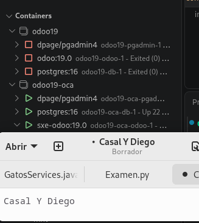
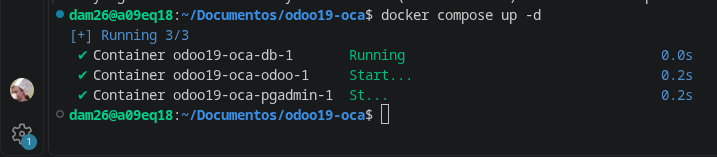
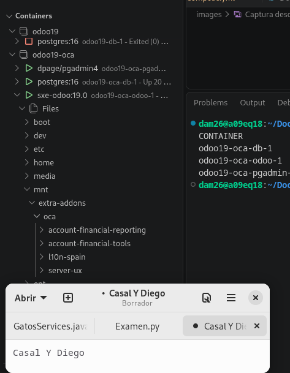
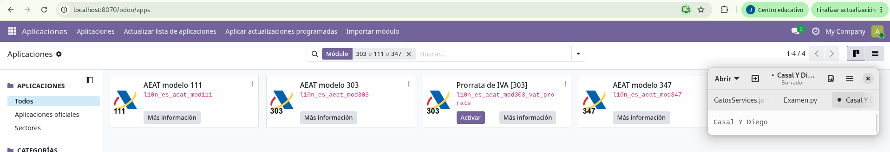
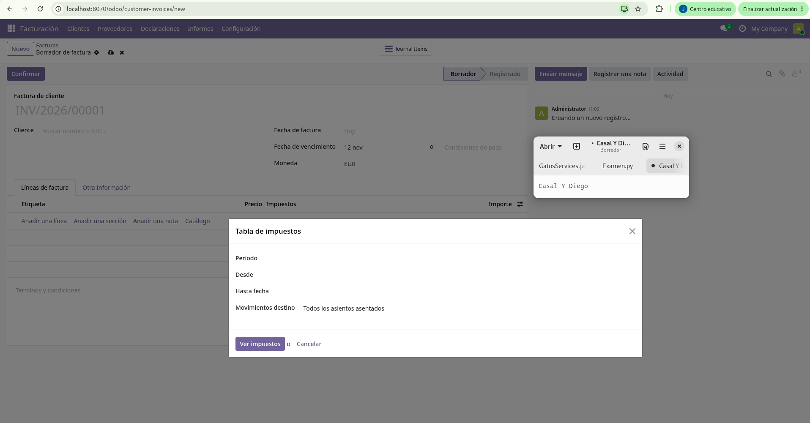
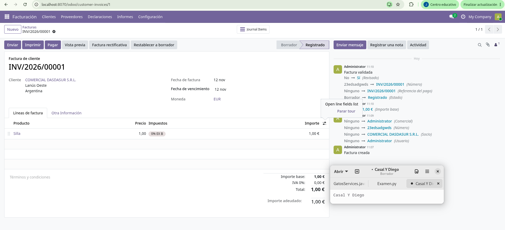

# 🚀 Manual de Implantación de Odoo 19 con Docker Compose

**Autores:** Casal y Diego  

Este repositorio contiene la configuración y la guía paso a paso para la implantación y puesta en marcha de **Odoo 19** mediante contenedores Docker (`odoo19-oca`), incluyendo la localización española (OCA) y las evidencias de verificación.

---

## 📑 Índice

> 📌 **Navegación Rápida**
>
> * [1. Estructura del proyecto y dependencias](#1-estructura-del-proyecto-y-dependencias)
> * [2. Integridad de la pila oficial (`odoo19`) y despliegue](#2-integridad-de-la-pila-oficial-odoo19-y-despliegue)
> * [3. Verificación de imagen personalizada (`sxe-odoo`) y rutas de addons](#3-verificación-de-imagen-personalizada-sxe-odoo-y-rutas-de-addons)
> * [4. Módulos instalados en Aplicaciones](#4-módulos-instalados-en-aplicaciones)
> * [5. Pruebas funcionales: Impuestos y Facturación](#5-pruebas-funcionales-impuestos-y-facturación)
> * [6. Exclusión de `addons/oca/` en el repositorio](#6-exclusión-de-addonsoca-en-el-repositorio)
> * 🚨 [7. Incidencias y solución de problemas](#7-incidencias-y-solución-de-problemas)
> * 🤖 [8. Declaración del uso de Inteligencia Artificial](#8-declaración-del-uso-de-inteligencia-artificial)

---

## 1. Estructura del proyecto y dependencias

El siguiente esquema muestra el árbol de dependencias necesario para el funcionamiento del **Modelo 303 (AEAT)** a partir de los repositorios de la OCA (`OCA/l10n-spain` y `OCA/account-financial-reporting`, rama `19.0`):

```text
[ MÓDULO PRINCIPAL OCA ]
└── l10n_es_aeat_mod303       (OCA/l10n-spain [19.0])
    ├── l10n_es_aeat          (OCA/l10n-spain [19.0])
    │   ├── l10n_es           (OCA/l10n-spain [19.0])
    │   │   ├── account       (Núcleo de Odoo)
    │   │   └── base          (Núcleo de Odoo)
    │   └── account           (Núcleo de Odoo)
    ├── account_tax_balance   (OCA/account-financial-reporting [19.0])
    └── account_debit_note    (Núcleo de Odoo / OCA según versión)
```

---

## 2. Integridad de la pila oficial (`odoo19`) y despliegue

Verificación en el gestor de contenedores de que la pila original de la Actividad 1 (`odoo19`) sigue intacta y detenida sin interferencias mientras se levanta el nuevo entorno aislado (`odoo19-oca`):



Levantamiento de los contenedores (`db`, `odoo` y `pgadmin`) mediante `docker compose up -d`:



---

## 3. Verificación de imagen personalizada (`sxe-odoo`) y rutas de addons

Ejecución de `docker compose images` confirmando que el contenedor activo (`odoo19-oca-odoo-1`) utiliza la imagen personalizada `sxe-odoo:19.0` con las librerías Python compiladas:


Comprobación dentro del sistema de archivos del contenedor (`/mnt/extra-addons/oca`) de que los repositorios de la OCA están correctamente montados y accesibles mediante `addons_path`:



---

## 4. Módulos instalados en Aplicaciones

Verificación de que los tres módulos principales de la localización española (`l10n_es_aeat_mod111`, `l10n_es_aeat_mod303` y `l10n_es_aeat_mod347`) aparecen correctamente reconocidos en el menú de **Aplicaciones**:



---

## 5. Pruebas funcionales: Impuestos y Facturación

Comprobación de la herramienta de **Tabla de impuestos** (aportada por la dependencia `account_tax_balance`) para auditar bases y cuotas por periodo:



Emisión y validación de una factura de cliente de prueba (`INV/2026/00001`) verificando el correcto funcionamiento contable y fiscal del sistema:



---

## 6. Exclusión de `addons/oca/` en el repositorio

Comprobación mediante `.gitignore` y `git status` asegurando que el código fuente clonado dentro de `addons/oca/` queda excluido del control de versiones del repositorio principal para mantenerlo ligero y limpio.

---

## 🚨 7. Incidencias y solución de problemas

Registro de errores encontrados durante el despliegue y cómo se resolvieron:

| Fecha | Síntoma / Problema | Causa | Solución |
| :--- | :--- | :--- | :--- |
| `12/11/2026` | Falla al ejecutar el levantamiento de contenedores (`docker compose up -d`). | Error tipográfico en el comando (`docker cosmpose`). | Corregir la sintaxis a `docker compose up -d`. |
| `12/11/2026` | Odoo no detecta los módulos de `l10n-spain` al actualizar la lista de aplicaciones. | Los módulos estaban anidados dentro de `/mnt/extra-addons/oca/l10n-spain` y Odoo solo escaneaba la raíz. | Añadir explícitamente las rutas de cada repositorio en el parámetro `addons_path` de `odoo.conf`. |
| `12/11/2026` | Error de dependencia faltante `account_tax_balance` al instalar el Modelo 303. | En Odoo 19 este módulo no está en `account-financial-tools`, sino en `account-financial-reporting`. | Clonar `OCA/account-financial-reporting` (rama `19.0`), añadir su ruta a `odoo.conf` y reiniciar el contenedor. |

---

## 🤖 8. Declaración del uso de Inteligencia Artificial

Durante la elaboración de esta práctica se ha utilizado Inteligencia Artificial como herramienta de apoyo para:

- 🔍 **Depuración:** Detección de errores de sintaxis en comandos, credenciales de Docker y rutas en `odoo.conf`.
- 🧩 **Gestión de dependencias:** Identificación y localización de los módulos requeridos por la localización española de la OCA en Odoo 19.
- 🔄 **Mantenimiento:** Guía de referencia rápida para la actualización de contenedores y listas de aplicaciones en Odoo.
- 📝 **Documentación:** Estructuración, corrección de enlaces y mejora visual del archivo `README.md`.
